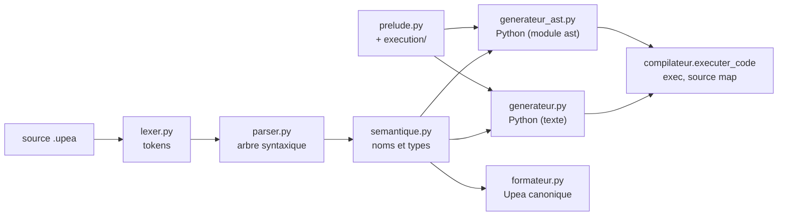
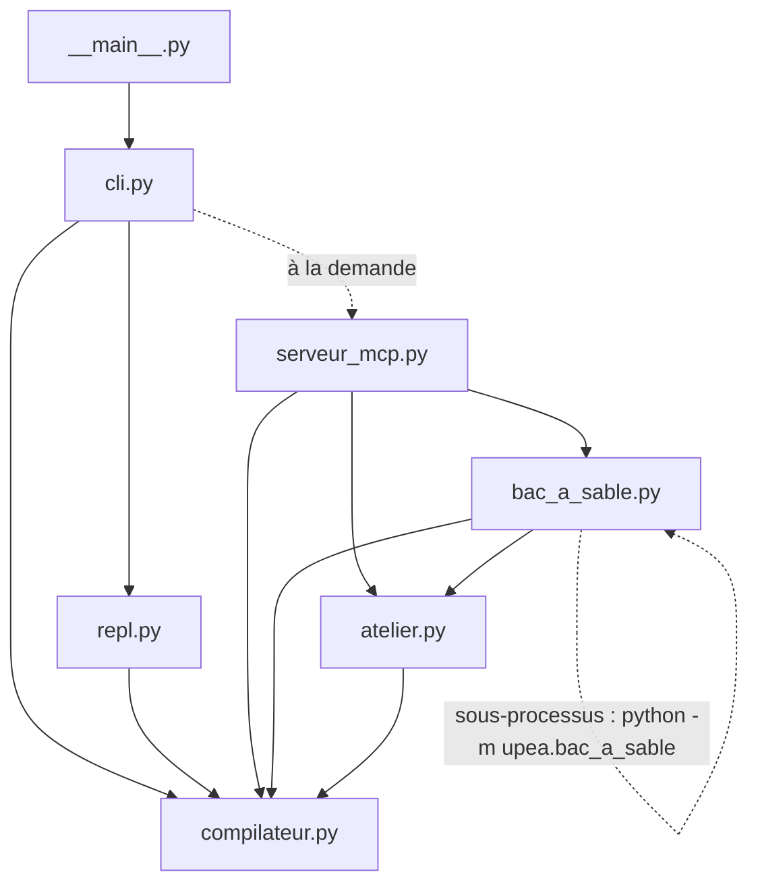

# Architecture d'Upea

Ce document décrit le compilateur : comment un programme Upea devient du Python et
s'exécute, le rôle de chaque module, et les choix de conception. Le langage lui-même
est décrit dans la [spécification](../projet/specification.md). Le code est dans
`projet/upea/`, et les chemins ci-dessous partent de ce dossier.

## 1. Vue d'ensemble

Un programme traverse quatre étages, comme le demande le cours : le lexer, le parser,
l'analyse sémantique et la génération de Python. La façade `compilateur.py` les
enchaîne. Les flèches du schéma suivent les données.



Autour de cette chaîne, chaque utilisateur passe par la façade. Ici, une flèche est un
import réel : « A → B » veut dire que A importe B.



Un exemple, étage par étage :

```upea
tuu x = 2;
faaite x + 3 * 4;
```

```sortie
14
```

Le lexer en tire ces tokens (leur `repr`, avec la ligne et la colonne) :

```text
Token(TUU, 'tuu', 1:1), Token(IDENT, 'x', 1:5), Token(EGAL, '=', 1:7),
Token(ENTIER, '2', 1:9), Token(POINT_VIRGULE, ';', 1:10), Token(FAAITE, 'faaite', 2:1),
Token(IDENT, 'x', 2:8), Token(PLUS, '+', 2:10), Token(ENTIER, '3', 2:12),
Token(ETOILE, '*', 2:14), Token(ENTIER, '4', 2:16), Token(POINT_VIRGULE, ';', 2:17),
Token(FIN, '', 3:1)
```

Le parser construit cet arbre (`noeuds.afficher_arbre`, ou `:arbre` dans le REPL) :

```text
Programme
├── instructions[0]: Declaration nom='x' constante=False
│   └── valeur: Entier valeur=2
└── instructions[1]: Affiche
    └── valeurs[0]: Binaire op='+'
        ├── gauche: Variable nom='x'
        └── droite: Binaire op='*'
            ├── gauche: Entier valeur=3
            └── droite: Entier valeur=4
```

Le générateur texte produit ce Python (ici avec `--prelude externe`, qui importe le
prélude au lieu de le recopier) :

```text
from upea_prelude import *


# --- programme Upea ---------------------------------------------------
x = 2
_affiche((x + (3 * 4)))
```

## 2. Du texte aux tokens

- `tokens.py` : `TokenKind`, l'énumération des sortes de token (mots-clés, symboles,
  littéraux), et `Token`, une dataclass gelée (sorte, lexème, position).
- `erreurs.py` : `Position` (ligne et colonne, à partir de 1), la hiérarchie des
  erreurs (`ErreurLexicale`, `ErreurSyntaxe`, `ErreurSemantique`, `ErreurType`,
  `ErreurExecution`, `Avertissement`), `ErreursMultiples`, et `formater`, qui écrit une
  erreur avec sa ligne et un `^` sous la colonne.
- `lexer.py` : `tokenize`, un **générateur** : les tokens sont produits un à un, et ceux
  qui précèdent une erreur sont déjà là (l'outil MCP `tokenize` s'en sert). Il refuse
  les identifiants qui commencent par `_`, réservés au code généré.
- `flux.py` : `Flux`, un regard en avant sur un itérable, qui n'en tire que ce qu'il
  faut.

## 3. Des tokens à l'arbre

- `noeuds.py` : une dataclass gelée par construction du langage, regroupées en deux
  unions, `Expr` et `Instr`, et la racine `Programme`. La position est exclue de `==` :
  deux arbres de même structure sont égaux, quelle que soit la mise en page. Le module
  fournit aussi les parcours génériques (`parcourir`, `afficher_arbre`).
- `parser.py` : une **descente récursive** pour les instructions, et la **méthode de
  Pratt** pour les expressions. Les règles d'expression s'enregistrent par des
  décorateurs paramétrés (`@prefixe(T.MOINS)`, `@infixe(T.PAR_G,
  precedence=Precedence.APPEL)`) dans
  `REGLES_PREFIXE` et `REGLES_INFIXE`. Chaque méthode cite sa règle de grammaire dans
  sa docstring.
- **Récupération d'erreurs** : une erreur de syntaxe est notée, le parser saute jusqu'au
  début probable de l'instruction suivante, et continue (`MAX_ERREURS = 20` au plus).
  Toutes les erreurs sont levées ensemble, dans une `ErreursMultiples`.
- **Limites d'imbrication** : 90 blocs, 20 boucles, 150 niveaux d'expression. Ce sont
  les limites de CPython ; le parser les vérifie, pour que `check` refuse ce que Python
  refuserait de compiler (lot L1 du conseil).

## 4. Noms et types

- `symboles.py` : la table des symboles, une pile de portées (les prédéfinies, la
  portée globale, puis les blocs ouverts). Une portée s'ouvre par un context manager,
  et se referme quoi qu'il arrive.
- `semantique.py` : l'analyseur, un visiteur à base de `singledispatchmethod` (une
  variante par sorte de nœud). Il vérifie les déclarations, les portées, l'absence de
  masquage, les `faaea` hors d'une boucle, et produit les avertissements (variable
  jamais utilisée, code après `hoi`). Il vérifie aussi les types, sauf avec
  `--sans-types`.
- `typage.py` : les types (simples, et paramétrés : `tapura[T]`, `tumu[T]`,
  `upea[T]`…), la compatibilité, le type commun. Le typage est **graduel** : un type
  inconnu (`?`) est compatible avec tout.
- `predefinies.py` : les fonctions prédéfinies vues du compilateur, leur nombre
  d'arguments et leur typeur. La plupart s'écrivent en une ligne avec des **patrons**
  (`signature("tri_topologique", GRAPHE, retour=fixe(INCONNU))`), qui donnent aussi
  leur signature lisible,
  exposée par la ressource MCP `upea://predefinies`.

## 5. Les backends

`backend.py` définit le contrat d'un backend : un `Protocol`, sans héritage (un nom,
une extension, `executable`, et `generer(programme, analyse) -> Sortie`).
`compilateur.BACKENDS` les range par nom. Ajouter un backend ne demande ni de toucher à
la CLI ni aux autres backends (la recette est dans le guide du développeur,
`docs/developpement.md`).

| Backend | Module | Ce qu'il produit |
|---|---|---|
| `python` | `generateur.py`, avec `emetteur.py` | du Python, sous forme de texte, ligne par ligne |
| `ast` | `generateur_ast.py` | l'arbre Python lui-même (module `ast`), écrit par `ast.unparse` (extension 11) |
| `formateur` | `formateur.py`, avec `emetteur.py` | le programme Upea dans sa présentation canonique ; ce n'est pas du Python (`executable` est faux) |

Les deux générateurs de Python produisent le même programme : un test différentiel
compare leurs arbres Python, sur les exemples et sur des programmes tirés au hasard.

## 6. Le prélude

Les arbres, les graphes, les algorithmes et les fonctions prédéfinies sont écrits en
Python, dans le paquet `execution/` : de vrais modules, vérifiés par mypy et testés.

- `prelude.py` met ces modules bout à bout, dans l'ordre de `prelude.MODULES` (`base`,
  `tumu`, `recherche`, `arbre_b`, `tas`, `vues`, `algorithmes_arbres`, `graphes`,
  `algorithmes_graphes`, `dessins`, `exports`, `predefinies`), et retire leurs imports
  relatifs, repérés avec `ast`. Le texte obtenu est recopié en tête de chaque fichier
  généré, qui reste ainsi autonome.
- Tous les noms du prélude commencent par `_`, et le lexer interdit ce préfixe : aucun
  programme ne peut les écraser. Un nom de programme qui est un mot-clé ou une fonction
  native de Python est renommé (`print` devient `_v_print`, `prelude.nom_python`).
- `transpile --prelude externe` écrit le prélude à côté, dans `upea_prelude.py`, que le
  fichier généré importe.
- Les fonctions du prélude vérifient leurs arguments (`@_attend`, `@_sur_graphe`) et
  lèvent une erreur en termes d'Upea. Les algorithmes d'arbres ne sont pas récursifs :
  un arbre dégénéré ne sature pas la pile. Une fonction du programme peut, elle,
  s'appeler 20 000 fois en chaîne (`execution/base.py`).

## 7. Exécuter, et rapporter les erreurs

`compilateur.py` est la façade (étape 9) : `compiler`, `analyser_syntaxe`,
`transpiler`, `executer`, `mettre_en_forme`. Rien d'autre n'appelle directement le
lexer, le parser ou les générateurs.

- Pendant la génération, l'émetteur note la ligne Upea de chaque ligne Python (`with
  emetteur.depuis(ligne):`). Cela donne une **source map** (`sourcemap.py`), décalée des
  lignes du prélude, et que `transpile --sourcemap` écrit à côté du fichier
  (extension 13).
- Le code est compilé sous un nom reconnaissable (`<upea>`). Quand il lève une
  exception, `lignes_du_programme` parcourt le traceback, garde les frames du programme,
  et traduit la ligne la plus profonde. `traduire` donne un message en termes d'Upea
  (`TRADUCTIONS`, une table de motifs pour les messages de `TypeError`).
- L'`ErreurExecution` est chaînée à l'exception d'origine (`from`) : `run --trace`
  montre le traceback Python, sinon il n'apparaît jamais.

Une erreur au fond d'une fonction est signalée à la ligne de la fonction :

```upea
ohipa premier_apres(l, i) {
    hoi l[i + 1];
}
faaite premier_apres([1, 2], 1);
```

```erreur
exemple.upea:2 : erreur d'exécution : indice hors limites
        hoi l[i + 1];
```

## 8. La CLI et le REPL

- `cli.py` : `main(argv)`, avec `argparse`, et une fonction par sous-commande (`run`,
  `transpile`, `check`, `fmt`, `repl`, `mcp`). Les codes de retour sont ceux de la
  spécification (*Utilisation*) : 0, 1, 2, 3 et 130. `main` rend le code au lieu de
  quitter, pour que les tests l'appellent directement.
- `repl.py` : le REPL est un **générateur** qui reçoit chaque ligne par `send` et rend
  une `Reponse` (la sortie, et l'invite suivante). Il garde le source des saisies
  acceptées, pour l'analyse, et l'espace de noms Python, pour les valeurs. Chaque saisie
  est compilée sous son propre nom (`<upea-1>`, `<upea-2>`…), avec sa source map : une
  erreur levée dans une fonction d'une saisie antérieure pointe la bonne ligne.

## 9. Le serveur MCP

Le serveur (extension 18) prête le compilateur à une IA ; son usage est décrit dans
le guide du serveur MCP, `docs/mcp.md`.

- `atelier.py` : les outils sans exécution (`decouper`, `analyser_syntaxe`, `verifier`,
  `transpiler`, `formater`) sous forme de fonctions qui rendent des dataclasses. Une
  erreur du programme est un **résultat** (des diagnostics), pas une panne. Le module ne
  dépend pas du SDK `mcp`.
- `bac_a_sable.py` : l'exécution dans un sous-processus, `python -m upea.bac_a_sable`.
  Le parent lui passe la requête en JSON sur son entrée standard ; l'enfant borne sa
  mémoire et son temps CPU, plafonne sa sortie, puis écrit un marqueur tiré au hasard
  et le résultat en JSON. Sa docstring répond à la question de sécurité du cours.
- `serveur_mcp.py` : le seul module qui importe le SDK. Il déclare les outils, les
  ressources et les prompts, limite la taille des sources, et transforme les pannes en
  erreurs d'outil. La CLI ne l'importe qu'à la demande : sans le SDK, le reste marche.

## 10. Le rôle de chaque module

| Module | Rôle | Étape du cours | Tests |
|---|---|---|---|
| `tokens.py` | sortes de token, `Token` | 2 | `test_etape_02_tokens.py` |
| `erreurs.py` | positions, erreurs, mise en forme | 2, 3 | `test_etape_02_tokens.py`, `test_etape_03_lexer.py` |
| `flux.py` | regard en avant | 3 | `test_etape_03_lexer.py` |
| `lexer.py` | texte → tokens | 3 | `test_etape_03_lexer.py` |
| `noeuds.py` | nœuds de l'arbre, parcours | 4 | `test_etape_04_noeuds.py` |
| `parser.py` | tokens → arbre, récupération d'erreurs | 5, 6 | `test_etape_05_expressions.py`, `test_etape_06_instructions.py` |
| `symboles.py` | table des symboles | 7 | `test_etape_07_semantique.py` |
| `semantique.py` | analyse sémantique et types | 7, 12 | `test_etape_07_semantique.py`, `test_extension_12_types.py` |
| `typage.py` | types et compatibilité | 12 | `test_extension_12_types.py` |
| `predefinies.py` | prédéfinies vues du compilateur | 12, 18 | `test_etape_08_execution.py`, `test_extension_18_signatures.py` |
| `emetteur.py` | lignes indentées, correspondance des lignes | 8 | `test_etape_08_generation.py` |
| `generateur.py` | backend `python` | 8 | `test_etape_08_generation.py`, `test_etape_08_execution.py` |
| `prelude.py`, `execution/` | le prélude | 8, 14 à 16 | `test_etape_08_execution.py`, `test_extension_14_structures.py`, `test_extension_15_algorithmes.py`, `test_extension_16_affichage.py` |
| `compilateur.py` | la façade, l'exécution, la traduction des erreurs | 9 | `test_etape_09_cli_repl.py` |
| `cli.py`, `__main__.py` | la ligne de commande | 9 | `test_etape_09_cli_repl.py` |
| `repl.py` | le REPL | 9 | `test_etape_09_cli_repl.py`, `test_conseil_m5_repl_lignes.py` |
| `backend.py` | le `Protocol` des backends | 10 | `test_etape_10_qualite.py` |
| `formateur.py` | backend `formateur` | 10 | `test_etape_10_qualite.py` |
| `generateur_ast.py` | backend `ast` | 11 | `test_extension_11_ast.py` |
| `sourcemap.py` | source maps | 13 | `test_extension_13_sourcemaps.py` |
| `atelier.py` | outils sans exécution | MCP 2, 3 | `test_extension_18_atelier.py` |
| `bac_a_sable.py` | exécution isolée | MCP 4 | `test_extension_18_bac_a_sable.py` |
| `serveur_mcp.py` | le serveur MCP | MCP 2 à 6 | `test_extension_18_mcp.py` |

Les fichiers `test_conseil_*` vérifient les corrections de l'audit du conseil (L1 à
M6), et `test_extension_17_proprietes.py` les propriétés tirées au hasard.

## 11. Choix de conception, et leur raison

| Choix | Raison |
|---|---|
| un lexer **générateur** | les tokens lus avant une erreur restent disponibles, et le parser ne tire que ce qu'il consomme |
| Pratt pour les expressions, règles enregistrées par décorateur | une priorité de plus est une ligne de plus ; les règles se testent seules |
| des erreurs collectées, pas levées une à une | un programme faux montre toutes ses erreurs de syntaxe d'un coup |
| les limites d'imbrication de CPython vérifiées par le parser | `check` ne doit pas accepter ce que Python refusera de compiler |
| pas de masquage d'un nom | Python n'a pas de portée de bloc : sans cette règle, le code généré changerait de sens (spécification, *Variables, constantes et portées*) |
| un typage graduel, désactivable | les erreurs de type sont signalées à la compilation, et `--sans-types` laisse voir ce que l'exécution ferait |
| un `Protocol` pour les backends | un backend nouveau n'hérite de rien et ne modifie rien (principe ouvert/fermé) |
| le prélude en vrais modules Python, recopié | il est typé et testé comme le reste, et le fichier généré se lance seul |
| les noms du prélude en `_`, interdits au programme | aucune collision possible entre le programme et le prélude |
| les textes écrits par `repr` (ou `ast.Constant`) | aucun texte ne peut devenir du code |
| la source map, et la traduction des exceptions | l'utilisateur voit une ligne et un message d'Upea, jamais un traceback Python |
| le REPL en générateur | il se teste sans console, saisie par saisie |
| l'atelier sans le SDK, le serveur seul à l'importer | le compilateur n'a aucune dépendance, et l'atelier se teste sans MCP |
| l'exécution MCP dans un sous-processus | un programme qui boucle ou remplit la mémoire ne met pas le serveur en danger |
